# one2passport

把一台 FoloToy **AI Passport**（ESP32-C3 小设备）改造成「城市网络收音机 + Codex 编程伴侣 + 小智 AI 语音助手」：
联网后自动定位所在城市播放当地电台，也可以把语音指令送到电脑上的 Codex 执行，
任务进度、审批和结果回传到设备屏幕；还内置了小智 AI 云端语音对话。

> 这是社区项目，与 FoloToy 官方无关，也未获其背书。详见 [NOTICE](NOTICE)。

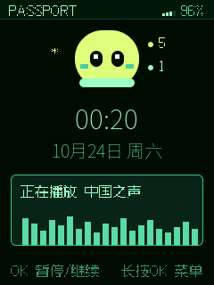

## 目录

- [第一次刷完固件后，按这个顺序做](#第一次刷完固件后按这个顺序做)
- [功能总览](#功能总览)
- [首页](#1-首页)
- [应用菜单](#2-应用菜单)
- [收音机](#3-收音机)
- [设置](#4-设置)
- [Codex 编程伴侣](#5-codex-编程伴侣)
- [小智 AI](#6-小智-ai)
- [烧录与升级](#烧录与升级)
- [仓库边界与技术说明](#仓库边界与技术说明)
- [排障](#排障)

## 第一次刷完固件后，按这个顺序做

新设备、或者刚用 `0x0` 合并镜像整片刷写的设备，请严格按下面的顺序操作。

### 第 1 步：刷入固件

从 [one2passport Releases](https://github.com/Cvencent/one2passport/releases/latest) 下载
`AI-Passport-MERGED.bin`，用官方 web flasher 从 **`0x0`** 写入。

- `AI-Passport-MERGED.bin`：完整合并镜像，从 `0x0` 刷入，适合首次刷机和网页刷写工具。
- `Internet-Radio.bin`：仅应用分区，从 **`0x10000`** 刷入，适合保留已有 Wi-Fi 记录的升级。

> 首次刷机不要刷完就急着试声音：设备还没有 Wi-Fi，也还没有 CodexBridge，需要先完成下面几步配置。

### 第 2 步：给设备配网（第一次必须做）

设备开机后如果没有可用网络，会在约 30 秒后自动进入配网，打开热点 **`LEO Radio`**。
也可以主动进入：**首页 → 长按 OK 进入应用菜单 → 设置 → 网络设置 → 连接新网络**。

配网有两种方式，任选一种：

1. **在设备屏幕上直接配**：在 Wi-Fi 列表里上下选择家里的 2.4 GHz 网络，确认后
   用屏幕键盘输入密码，选 `GO` 连接。
2. **用手机或电脑网页配**：连接热点 `LEO Radio`，浏览器打开 `http://192.168.4.1`，
   填写 2.4 GHz 的 SSID 与密码后保存。

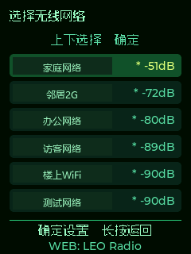
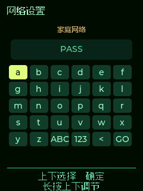

配网成功后设备会自动连接，并根据网络位置搜索所在城市的电台。

> 只支持 **2.4 GHz** Wi-Fi。设备与运行 CodexBridge 的电脑必须在同一个局域网。

### 第 3 步：在电脑上装好并启动 CodexBridge

CodexBridge 是电脑端的桥接程序，负责把 Codex 的任务状态、审批和结果转发到设备。

前置条件：

1. 电脑已安装 Codex，并且 **Codex App Server 使用 ChatGPT 账户登录**。
   API Key 登录可以用于 Codex CLI 本身，但不能替代桥接器需要的 ChatGPT App Server 登录状态。
2. 从 [CodexBridge Releases](https://github.com/Cvencent/CodexBridge/releases/latest)
   下载最新的 `CodexBridge.exe`，或从源码运行。
3. 电脑与设备在同一 **2.4 GHz** 局域网。
4. Windows 已装中文语音识别与语音包（用于语音转文字）。

推荐直接运行 `CodexBridge.exe`，它会以托盘程序运行并提供管理接口。源码模式：

```powershell
cd <CodexBridge 仓库目录>
python -m pip install -e ".[tray]"
python -m codexbridge
```

### 第 4 步：在 CodexBridge 里批准设备

CodexBridge 启动后会自动发现同一局域网里的设备（UDP 8764）。

1. 打开托盘菜单，等待设备出现在列表里。
2. 批准这台设备，并按需开启它的能力（状态、任务、结果、审批、语音、已读回执等）。
3. 设备上报的标识形如 `aipassport-<mac>`，型号为 `FoloOS-AI-Passport`。

设备联网、Bridge 批准完成后，首页会通过 UDP 收到任务计数，进入 Codex 页即可看到已连接状态。

### 第 5 步：开始日常使用

完成上面四步后：

- 首页自动播放当前城市电台；按 OK 暂停/继续，长按 OK 进菜单。
- 长按 UP 或长按 DOWN 可快捷进入 Codex 页。
- 需要语音对话：先确认电脑上的 CodexBridge 已运行，再在小智 AI 页长按 OK 说话。

### 首次刷机检查清单

- [ ] 固件从 `0x0` 刷入，设备能正常开机亮屏
- [ ] 设备已连上 2.4 GHz Wi-Fi（首页右上角信号格亮起）
- [ ] 首页显示城市电台名称与波形，声音正常
- [ ] 电脑已启动 CodexBridge，并已批准本设备
- [ ] 进入 Codex 页显示已连接（而不是“请启动电脑端桥接”）
- [ ] 需要小智 AI 时，已按屏幕提示在 `xiaozhi.me` 完成设备绑定

## 功能总览

| 功能 | 入口 | 说明 |
| --- | --- | --- |
| 城市网络收音机 | 首页 / 应用菜单 → 收音机 | 自动定位城市并按热度播放当地电台，可手动切换城市 |
| 定时播放 | 设置 → 定时播放 | 15 / 30 / 60 / 90 分钟，到点自动休眠 |
| 屏幕设置 | 设置 → 屏幕设置 | 亮度四档、自动熄屏五档 |
| 网络设置 | 设置 → 网络设置 | 连接新网络、已存网络管理、设为首选、删除 |
| Codex 编程伴侣 | 应用菜单 → Codex，或首页长按下键 | 电脑端任务状态、审批、结果回传，支持语音下指令 |
| 小智 AI | 应用菜单 → 小智AI | 直连小智云端语音助手，长按 OK 说话 |
| 应用菜单 | 首页长按 OK | 手表式单图标轮播，共四个应用 |
| 息屏唤醒 | 任意页面 | 熄屏后任意键只唤醒屏幕，不会误触发操作 |
| 电池与信号 | 首页 / 菜单顶栏 | 实时显示电量与 Wi-Fi 信号强度 |
## 1. 首页


首页是设备最常停留的页面，同时也是后台最小化服务的运行层。

| 区域 | 内容 |
| --- | --- |
| 顶栏 | 品牌名、Wi-Fi 信号格、电池电量 |
| 宠物 | 颜色与表情跟随 Codex 状态变化（空闲 / 运行 / 完成 / 失败 / 离线 / 待审批） |
| 宠物右侧徽标 | 进行中、已完成、失败的 Codex 任务计数（为 0 时隐藏） |
| 时间区 | 当前时间与日期 |
| 播放卡片 | 正播放的电台名 + 实时频谱波形 |

按键操作：

| 操作 | 效果 |
| --- | --- |
| 点击 OK | 暂停 / 继续当前电台 |
| 长按 OK | 进入应用菜单 |
| 长按 UP | 进入应用菜单 |
| 长按 DOWN | 快捷进入 Codex 页 |

> 首页/菜单只运行最小化服务：收音机继续播放，Codex 桥后台接收计数与未读结果，
> 但不创建完整应用页面。进入完整应用时会把资源让给前台应用。

## 2. 应用菜单

首页长按 OK 或长按 UP 进入应用菜单。用上下键在四个应用之间轮播，点击 OK 进入。

| 收音机 | Codex |
| --- | --- |
| 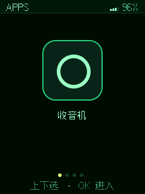 | 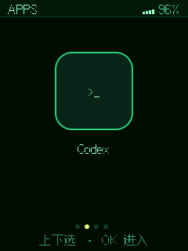 |

| 小智AI | 设置 |
| --- | --- |
| 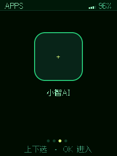 | 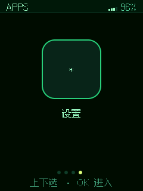 |

- 菜单顶部同样显示 Wi-Fi 信号与电量。
- 底部圆点表示当前选中的是第几个应用。
- 菜单内长按 UP 返回首页。

## 3. 收音机

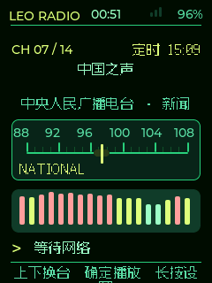

完整收音机页显示频道号、城市与电台信息、频率刻度、频谱柱以及播放状态。

| 区域 | 说明 |
| --- | --- |
| `LEO RADIO` | 固件品牌 |
| `CH 07 / 14` | 当前电台序号 / 总数 |
| 定时 | 定时播放剩余时间（未开启时不显示） |
| 电台名 | 当前播放的电台 |
| 城市电台 · 网络直播 | 当前来源 |
| 频率刻度 | FM 频段与当前频率指针 |
| 频谱柱 | 实时音频电平 |
| 状态 | `正在播放` / `正在缓冲` / `等待网络` / `已暂停` |

按键操作：

| 操作 | 效果 |
| --- | --- |
| 点击 UP | 上一个电台 |
| 点击 DOWN | 下一个电台 |
| 点击 OK | 播放 / 暂停 |
| 长按 OK | 进入设置 |
| 长按 UP | 返回应用菜单 |

城市电台会自动按热度排序；手动选择城市后，后台会重新加载该城市的电台列表。

## 4. 设置

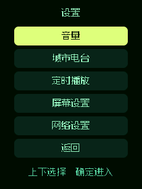

设置项从上到下依次是：音量、城市电台、定时播放、屏幕设置、网络设置、返回。

通用导航规则：

| 操作 | 效果 |
| --- | --- |
| 点击 UP / DOWN | 上下选择 |
| 点击 OK | 进入或确认 |
| 长按 OK | 返回上一级（网络相关的三个子页也可用） |
| 长按 UP | 返回上一级；在设置首页返回菜单 |

### 4.1 音量

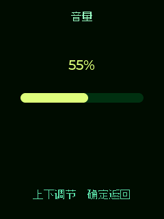

- 点击 UP / DOWN：步进 5 调整音量（范围 10%–100%）。
- 长按 UP / DOWN：步进 10 快速调整。
- 点击 OK：返回设置菜单。
- 音量对所有前台应用生效，Codex 提示音也跟随这个音量。

### 4.2 城市电台

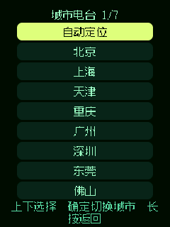

- 第一项是「自动定位」，其余是内置城市，一屏 9 行，上下翻页。
- 点击 OK：切换城市或回到自动定位，选定后立即返回并重新加载电台。
- 长按 OK：返回设置菜单。
- 所选城市会保存在设备里，重启后继续生效。

### 4.3 定时播放

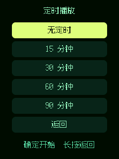

- 可选：无定时、15 分钟、30 分钟、60 分钟、90 分钟。
- 点击 OK 开始计时并返回设置菜单；首页/收音机页会显示剩余时间。
- 到时后自动停止播放、关闭无线网络和屏幕，进入深度睡眠。
- 重新上电后定时默认为关闭。

### 4.4 屏幕设置

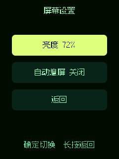

- **亮度**：25% / 50% / 72% / 100%，点击 OK 循环切换。
- **自动熄屏**：关闭 / 30 秒 / 1 分钟 / 5 分钟 / 10 分钟，点击 OK 循环切换。
- 熄屏不会停止播放；熄屏后按任意键只唤醒屏幕，不会误触发换台或暂停。
- 亮度与熄屏设置会保存在设备中，重启后继续生效。

### 4.5 网络设置

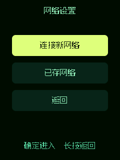

网络设置包含「连接新网络」「已存网络」「返回」。

**连接新网络**


- 上下选择附近的 2.4 GHz 网络。
- 点击 OK 进入密码键盘：字母 / 大写 / 数字符号三种页面。
- 长按 UP / DOWN 可一次跳 6 个按键，加快输入。
- 选 `<` 删除上一个字符；密码为空时再按 `<` 返回列表。
- 选 `GO` 开始连接；长按 OK 可退出配网并回到原来的网络。

**已存网络**

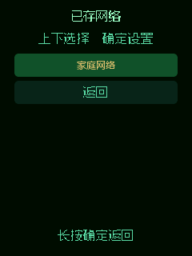

选中某个网络后可以：

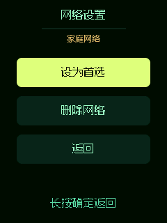

- **设为首选**：下次开机优先连接这个网络。
- **删除网络**：进入确认页，删除后不再自动连接。

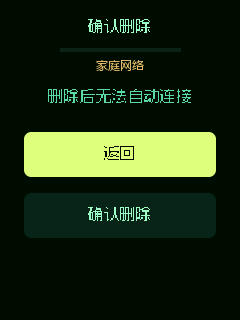
## 5. Codex 编程伴侣

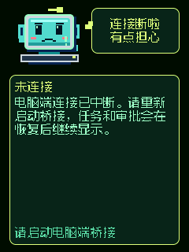

Codex 页把电脑上的 Codex 会话搬到设备上：顶部是动画形象与状态气泡，
中间是任务内容，底部是可选择的动作按钮。

支持的页面状态包括：

| 状态 | 说明 |
| --- | --- |
| 已连接 / 空闲 | 可以按 OK 开始说话 |
| 录音中 | 长按或点击 OK 结束录音 |
| 识别中 | 正在把语音转成文字 |
| 确认中 | 发送前确认识别出的文字 |
| 排队中 | 已发送，等待电脑端接收 |
| 工作中 | Codex 正在执行，显示已用时 |
| 待审批 | 需要你在设备上做选择 |
| 任务完成 | 显示完成用时与已读人数 |
| 任务失败 | 显示失败原因，可重新录音 |
| 未连接 | 电脑端桥接未运行或连接中断 |

按键操作：

| 操作 | 效果 |
| --- | --- |
| 点击 UP / DOWN | 在动作、选项、列表中上下移动 |
| 点击 OK | 确认；在“录音”动作上开始/结束录音 |
| 录音结束后 | 等待识别，确认文字后发送 |
| 长按 UP | 返回上一级；在主页面返回应用菜单 |

其他行为：

- 结果页停留满 2 秒会自动上报 `read_ack`，多台设备的已读状态由 CodexBridge 同步。
- 任务在后台运行时，首页宠物与计数徽标会同步变化。
- 长按 UP 只退出页面，不会停止电脑上正在运行的 Codex 任务。

### 选择项目和会话

进入 Codex 后，选择「切换任务」会向电脑端请求真实项目列表：

1. 先显示「选择项目」，上下选择项目后按 OK。
2. 再显示「选择任务」，上下选择会话后按 OK。
3. 打开会话后即可看到最后一段助手文本，并可继续用语音下指令。

> 项目与会话列表由 CodexBridge 实时下发，设备本地不缓存历史对话，只显示最后一段，
> 以适应 ESP32-C3 无 PSRAM 的内存限制。

## 6. 小智 AI

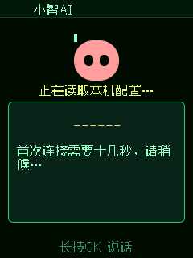

小智 AI 直连小智云端语音服务，不经过 CodexBridge。

| 状态 | 说明 |
| --- | --- |
| 连接中 | 正在获取配置、准备语音引擎、建立连接 |
| 待激活 | 屏幕显示设备码，请在 `xiaozhi.me` 输入完成绑定 |
| 空闲 | 长按 OK 说话 |
| 正在聆听 | 短按 OK 结束 |
| 思考中 | 云端识别与生成回答 |
| 回答中 | 播放云端回复 |
| 连接失败 / 无响应 | 可再次长按 OK 重试 |

按键操作：

| 操作 | 效果 |
| --- | --- |
| 长按 OK | 开始说话（按住说话） |
| 松开 OK | 结束说话，等待识别与回答 |
| 短按 OK | 正在聆听时也可结束本轮 |
| 长按 UP | 返回应用菜单 |

首次使用小智需要进行设备激活：按屏幕提示访问 `xiaozhi.me`，输入设备上显示的设备码。

## 按键速查

| 场景 | UP | DOWN | OK |
| --- | --- | --- | --- |
| 首页 | 长按：进入应用菜单 | 长按：快捷进入 Codex | 点击：暂停/继续；长按：进入菜单 |
| 应用菜单 | 点击：上一个应用 | 点击：下一个应用 | 点击：进入应用 |
| 收音机 | 点击：上一个电台 | 点击：下一个电台 | 点击：播放/暂停；长按：设置 |
| 设置列表 | 点击：上移 | 点击：下移 | 点击：进入；长按：返回上一级 |
| 音量 | 点击/长按：减小 | 点击/长按：增大 | 点击：返回 |
| Wi-Fi 键盘 | 点击：上移；长按：跳 6 格 | 点击：下移；长按：跳 6 格 | 点击：输入；长按：连接 |
| Codex | 点击：上移 | 点击：下移 | 点击：确认 / 开始或结束录音 |
| 小智 AI | — | — | 长按：开始说话；松开：结束 |

熄屏状态下：任意键只负责点亮屏幕，不会执行该键原来的功能。

## 烧录与升级

固件目标为 ESP-IDF 5.5.3 / ESP32-C3，8 MB Flash，无 PSRAM。

```sh
. $IDF_PATH/export.sh
cd firmware
idf.py set-target esp32c3
idf.py build
idf.py -p <PORT> flash monitor
```

生成可从 `0x0` 刷入的合并镜像：

```sh
python firmware/merge_bin.py --build-dir firmware/build --out AI-Passport-MERGED.bin
```

分区表：

| 分区 | 偏移 | 说明 |
| --- | --- | --- |
| `nvs` | `0x009000` | Wi-Fi 与设备设置 |
| `phy_init` | `0x00F000` | RF 校准数据 |
| `factory` | `0x010000` | 主应用程序 |
| `cardid` | `0x356000` | 设备标识 |
| `easter` | `0x360000` | 彩蛋资源 |
| `recovery` | `0x700000` | Recovery |

升级注意事项：

- 应用升级包从 `0x10000` 写入，只更新应用程序。
- 不要擦除 NVS，否则已保存的 Wi-Fi 与配对 token 会丢失。
- 若要把已配网的设备转交给别人，请先清除 Wi-Fi 记录，再由新主人重新配网。
## 仓库边界与技术说明

- 本仓库只维护 AI Passport 设备端固件。
- PC 端桥接器位于 [Cvencent/CodexBridge](https://github.com/Cvencent/CodexBridge)。
- 旧版内置 Windows 客户端 `windows-client/` 已不再随本仓库发布或维护。

设备端使用统一协议：

```text
发现请求：CODEXBRIDGE_DISCOVER
发现应答：{"device": "...", "device_id": "...", "name": "...", "port": 8765, "capabilities": [...]}
握手顺序：bridge_auth -> bridge_auth_ok -> bridge_ready
消息类型：message、capabilities_update、read_state、read_ack、error
```

- 设备以 MAC 派生稳定 `device_id`（`aipassport-<mac>`），型号 `FoloOS-AI-Passport`。
- 固件声明支持 `status`、`text`、`tasks`、`results`、`read_ack`；实际启用项由
  CodexBridge 按设备配置，未启用的能力不会下发到设备。
- 结果页停留满 2 秒上报一次 `read_ack`，多台设备的已读状态由 CodexBridge 广播同步。
- 首页/菜单只通过 UDP 接收发现与任务计数，不建立 CBDP TCP 会话。

## 测试

固件测试位于 `firmware/tests/`。PC 端协议、设备管理、已读同步与托盘测试位于
[CodexBridge 仓库](https://github.com/Cvencent/CodexBridge)。

```sh
cd firmware
python tools/tests/run_tests.sh
```

## 排障

| 现象 | 处理 |
| --- | --- |
| 首次开机一直没有网络 | 等待约 30 秒会自动开配网热点 `LEO Radio`；也可进设置 → 网络设置手动配网 |
| Wi-Fi 列表里找不到自家网络 | 确认路由器开了 2.4 GHz 频段；设备不支持 5 GHz |
| 网页配网打不开 | 手机/电脑需先连上 `LEO Radio` 热点，再访问 `http://192.168.4.1` |
| Codex 页提示“请启动电脑端桥接” | 启动 CodexBridge，并确认设备已被批准、电脑与设备同网段 |
| CodexBridge 发现不到设备 | 确认设备已联网，且 UDP 8764 未被防火墙拦截 |
| CodexBridge 提示未登录 ChatGPT | 在 Codex App Server 使用 ChatGPT 账户登录；API Key 登录不等于可用 |
| 托盘里出现 `legacy:<IP>` 设备 | 那是旧 `bridge.json` 迁移记录；新固件会另以 `aipassport-<mac>` 上线 |
| 小智 AI 提示待激活 | 按屏幕设备码到 `xiaozhi.me` 完成绑定 |
| 小智 AI 提示“麦克风不可用” | 检查 `bsp_audio` 初始化；重启设备 |
| 设备端提示“内存不足 稍后重试” | 退出占用内存的应用后重试；这是 ESP32-C3 无 PSRAM 的正常限制表现 |
| 构建报 `lvgl/lvgl.h not found` | 确认 `main/CMakeLists.txt` 里有 `LV_LVGL_H_INCLUDE_SIMPLE` 定义 |
| 构建报 `undefined reference to wireless_bridge_*` | 确认相关头文件有 `extern "C"` 守卫 |

## 隐私

本仓库只包含源码与文档：不含 Wi-Fi 名称/密码、设备 MAC、配对 token，也不含开发者本机的绝对路径。
构建产物（`build/`、`managed_components/`、`sdkconfig`、日志与 BIN）一律不入库，只随 Releases 发布。

## 许可

MIT，详见 [`firmware/LICENSE`](firmware/LICENSE)。内置字库、Espressif 组件与第三方素材各自遵循其原始许可。

---

## English

`one2passport` is an unofficial community project for the FoloToy **AI Passport**
(ESP32-C3). It turns the device into a city internet radio, a Codex companion
screen, and a XiaoZhi AI voice assistant.

Quick start after flashing:

1. Flash `AI-Passport-MERGED.bin` at `0x0`.
2. Power on, wait for the `LEO Radio` setup hotspot (or open
   Settings -> Network -> Connect to a new network).
3. Join the hotspot and open `http://192.168.4.1`, or enter Wi-Fi credentials
   directly on the device screen (2.4 GHz only).
4. Install and start CodexBridge on a Windows PC, then approve the device in
   the tray menu.
5. Use the on-device UI: Home, Radio, Settings, Codex and XiaoZhi AI.

See the Chinese sections above for full per-screen documentation and screenshots.
The device speaks the unified CodexBridge protocol
(`CODEXBRIDGE_DISCOVER` plus `bridge_auth -> bridge_auth_ok -> bridge_ready`).
Licensed under MIT; see `firmware/LICENSE`.
